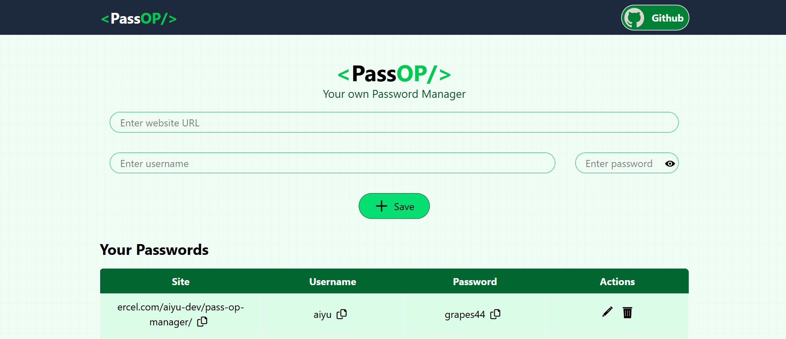

# PassOP - Your Personal Password Manager 🔐

PassOP is a modern web application designed to help you store and manage your website credentials locally in your browser. It provides a simple, clean interface to save, edit, delete, and copy your passwords with ease.

>⚠️**Note:** This is a learning project built to practice
React. Passwords are stored unencrypted in the
browser's localStorage, so please do not use it for
real, sensitive passwords. 

## 🚀 Live Demo
[View the Live Project Here](https://pass-op-manager.vercel.app/)

# 📸 Screenshots


## ✨ Key Features
- **Add Credentials:** Save website URL, username,
and password in one form.
- **Edit & Delete:** Update or remove any saved entry
anytime.
- **LocalStorage Storage:** Your data never leaves your
browser; nothing is sent to a server.
- **Copy to Clipboard:** One-click copy for website,
username, and password.
- **Password Visibility Toggle:** Show or hide
passwords while viewing or typing.
- **Toast Notifications:** Instant feedback when you
save, copy, edit, or delete.
- **Responsive Design:** Works on desktop and mobile
screens.

## 🛠️ Built With
- React.js (Vite)
- Tailwind CSS
- Lucide React (Icons)
- React-Toastify (Notifications)
- Browser localStorage API

## 📦 Installation
1. Clone the repo: 
```bash
git clone https://github.com/aiyu-dev/PassOP-Manager.git
```
2. Go into the project folder:
```bash
cd PassOP-Manager
```

3. Install dependencies: 
```bash
npm install
```
4. Start the dev server: 
```bash
npm run dev
```
5. Open the local URL shown in the terminal (usually
http://localhost:5173 ).

## 📚 What I Learned
- Managing state and side effects with React hooks
( useState , useEffect , useRef )
- Reading and writing data with the localStorage
API
- Building responsive UI with Tailwind CSS
- Adding user feedback with React-Toastify
- Deploying a Vite + React app on Vercel

## 🎓 Credits
This project was built as part of my learning journey,
following the tutorial by [CodeWithHarry](https://www.youtube.com/@CodeWithHarry). I
implemented the logic and styling manually to
strengthen my React fundamentals, and customized it
with my own UI styling, edit/delete handling, and
notifications.

# 👩‍💻 Author
*Ayesha Shahzad*
Frontend Developer | Computer Science Student

- GitHub: [aiyu-dev](https://github.com/aiyu-dev)

⭐ If you like this project, consider giving it a star!